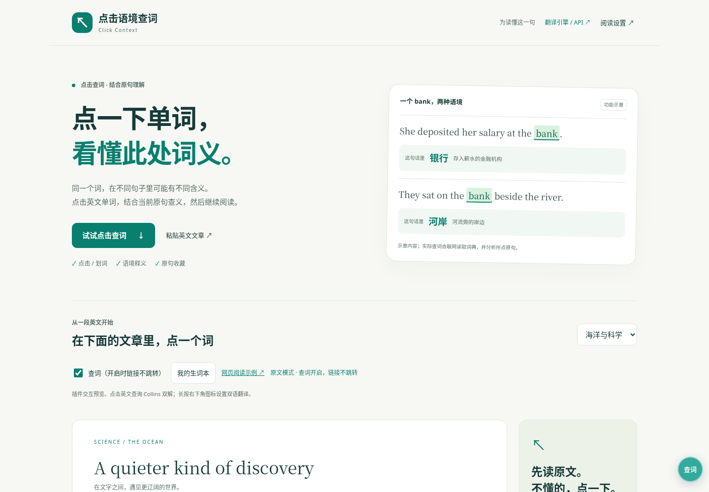
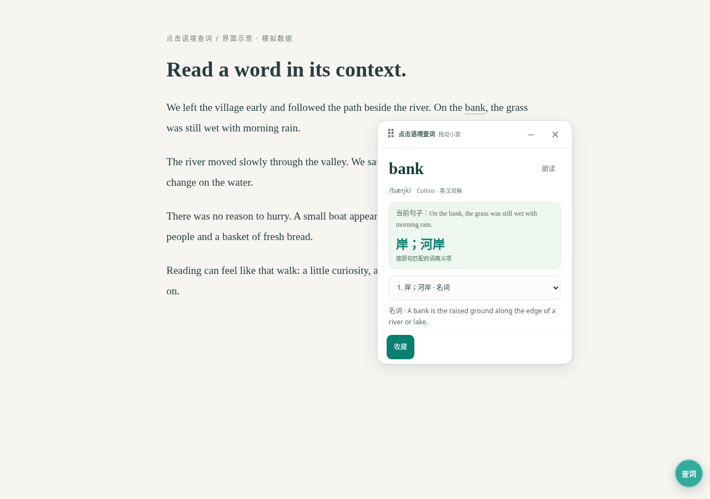

# 点击语境查词 · Click Context

> 当前源码为 **0.7.161 用户体验候选**：[打开独立预览](https://afa8efac.lextide.pages.dev/)。999 项本地测试通过。本轮优化慢存储下的草稿写入、未暂存输入的离开提醒和输入法收尾，阻止关闭后的迟到事件重新创建旧稿。已实际验证取消、保存和刷新恢复；手机强杀与 iPhone 真机未验收。原生 0.7.98 保留，未上传 GitHub，AI 后端和提示词未改。见[本轮验证记录](docs/diagnostics/2026-10-26-slow-draft-writes.zh-CN.md)。

**点一下单词，看懂它在这句话里的意思。**


源码仓库：[a1986884/click-context](https://github.com/a1986884/click-context) · [本次源码导入与历史恢复](SOURCE_IMPORT.md)

一个面向英文网页阅读的开源浏览器扩展。点击单词或划选短语，结合当前原句查看此处含义；保留 Collins 词典原义供对照，并把这次词义连同原句收藏下来。也支持选文翻译和网页双语阅读。

[体验当前候选预览](https://afa8efac.lextide.pages.dev/) · [安装与构建](docs/INSTALL.md) · [引擎与自带 API](docs/TRANSLATION_ENGINES.zh-CN.md) · [隐私说明](docs/PRIVACY.md) · [版本记录](docs/ITERATIONS.md) · [参与开发](CONTRIBUTING.md)

另有 [Tampermonkey 用户脚本试用版](userscript/README.zh-CN.md)（[安装页](https://click-context-install.aa1986884.workers.dev/)），本地开发版新增点击语境 AI 选择，另有正文/选文独立引擎、自带 API 和连接诊断。安装方式与扩展不同，实际 iPhone 管理器兼容性仍待验收。

当前开发与交付状态：

| 入口 | 版本 | 已知状态 |
| --- | --- | --- |
| 公开用户脚本安装页 | 本轮未重查 | 此前记录为 0.7.110；本轮未更新或重新验收 |
| 当前开发用户脚本 | 0.7.161 | 999 项本地测试通过，仍为候选，未上传 GitHub |
| 原生发布 | 0.7.98 | 独立保留，没有发布原生新包 |
| 独立网页预览 | 0.7.161 | 取消、保存和刷新恢复已实际验证；不等于原生或 iPhone 验收 |

本轮没有修改 AI 模型、提示词或后端；存储和输入法测试不代表语境质量验收。历史记录见[冲突双方自动保留](docs/diagnostics/2026-10-26-conflict-copies.zh-CN.md)、[草稿快照检查](docs/diagnostics/2026-10-26-draft-conflicts.zh-CN.md)、[撤销和小屏改进](docs/diagnostics/2026-10-26-ux-continuation.zh-CN.md)、[草稿恢复](docs/diagnostics/2026-10-25-draft-recovery.zh-CN.md)与[早期体验记录](docs/diagnostics/2026-10-25-ux.zh-CN.md)。早期[预览修复](docs/diagnostics/2026-10-24-preview-repair.zh-CN.md)、[容量错误排查](docs/diagnostics/2026-10-24-capacity-followup.zh-CN.md)、[自主恢复](docs/diagnostics/2026-10-25-autonomous.zh-CN.md)和[未执行的提示词对照准备](docs/diagnostics/2026-10-25-specificity-experiment.zh-CN.md)均保留，不作为当前语义验收。

以下保留为 0.7.129 的历史交接结果：

0.7.129 修正词典释义的匹配边界：完整原义与真正别名直接选择词典义项，括号内例举不冒充独立原义。806项单元、完整用户脚本浏览器及35组共享阅读器普通浏览器回归通过；真实内置服务本轮503失败，仍为未验收候选。此前语义/单位失败保留；真实厂商、原生及iPhone尚未验收。完整结果见 [用户脚本交接说明](userscript/README.zh-CN.md)。公开安装页仍110，本地候选未发布；GitHub工作流配置已准备，未声称远端CI通过。

> 原项目名 Lextide / 词汐。0.7.88 起使用「点击语境查词」；旧存储键和内部标识保留，已有生词与设置无需迁移。在线预览可能仍是较早版本，以页面版本标记为准。



## 为什么做这个工具

查到一个词的很多解释以后，还需要判断哪一个适合当前句子。

例如 `bank`：在存入薪水的句子里是“银行”，在坐在河边的句子里是“河岸”。点击语境查词将**所点的词、具体原句和词典候选义项**结合起来，帮助理解这一次用法。

AI 释义会明确标注；没有匹配词典义项或服务失败时也会说明。模型仍可能理解错误，重要内容请结合原文与词典核对。

## 可以做什么

| 功能 | 使用方式 |
| --- | --- |
| **点击语境查词** | 点英文单词，直接看原句与此处含义，可切换词典义项 |
| 划词 / 短语查询 | 选择词语后主动查询，支持变形和常见搭配 |
| 收藏这次用法 | 保存词义、原句与来源，同一词可保存不同语境 |
| 选中文本翻译 | 与词典卡分开显示，选择动作本身不发送请求 |
| 网页双语阅读 | 在设置中开启逐段或逐句英中对照，关闭后恢复原文 |
| 独立选择引擎 | 正文与选文分别选择，支持用户自带 API |



[查看工具栏](docs/images/toolbar.png) · [查看引擎设置](docs/images/engine-settings.png) · [查看窄屏界面](docs/images/overview-mobile.png)

截图使用明确标记的模拟数据展示界面，不代表真实提供商或原生安装验收。

## 怎么开始

1. 在浏览器工具栏打开扩展，启用当前标签页的**点击查词**。
2. 点击正文中的英文单词，查看当前原句与释义；需要时朗读、切换词典原义或收藏。
3. 选择一段文字后，可主动选择“查词 / 短语”或“翻译选文”。
4. 需要整篇对照时，长按浮动按钮或按 `Shift+F10` 打开阅读设置，开启正文双语。

查词开启时，正文英文链接用于查询而不跳转；点击浮动按钮关闭后恢复正常浏览。只有选择“记住网站”时才申请长期网站权限。

## 翻译引擎

正文与选文可独立选择 Google Cloud Translation、Microsoft Translator、DeepL、OpenAI Chat / Responses、Claude、Gemini，及采用兼容接口的 DeepSeek、Qwen、Kimi、GLM、豆包、Grok、PLaMo、Ollama 等。地址和模型 ID 可编辑，也可以接入自己的兼容 API。

网页预览顶部的“翻译引擎 / API”可查看服务和独立引擎选择。该页仅演示界面，不接收真实密钥、不保存或应用配置；真实接入在已安装插件的“翻译引擎 / 我的 API”中完成。

当语境返回的词义与对应词典原义一致时，词卡直接选中该词典义项；不同的语境解释仍明确标记AI来源，下拉只提供“查看词典原义”，不再占用“当前为语境释义”一项。

**词卡的 AI 语境释义目前使用 Cloudflare Workers AI**，与正文/选文引擎设置分开。Collins 内容读取自有道公开词条的 Collins 栏目，不是获授权的 Collins 官方 API。

AI 聊天会员不等于 API 额度；新增提供商目前主要完成模拟协议验证，真实可用性取决于有效 API 凭据、模型与服务。密钥保存在扩展自身 IndexedDB，不回显、不进入网页或生词本导出；不是硬件加密保险箱。详见[引擎说明](docs/TRANSLATION_ENGINES.zh-CN.md)。

## 本地构建

需要 Node 22+；浏览器验证还需 Git、Python 3 和允许使用的 Chromium。

```sh
npm ci --ignore-scripts
npm run check
npm test
npm run build:preview
npm run test:browser
npm run test:preview
npm run package
```

Chromium 扩展目录：`build/extension/`；插件 ZIP：`build/packages/`；本地预览：`dist/`。在允许安装扩展的桌面 Chrome / Edge 加载包含 `manifest.json` 的目录。更新后刷新文章页。兼容脚本生成的包文件名仍可能以 `lextide-` 开头。

源码 ZIP 可以在无 `.git` 的目录构建。完整源码与历史扫描、独立 ZIP 验证命令见[测试说明](docs/TESTING.md)。

## 当前边界

- 当前以英文到简体中文阅读为基线；不是所有网页、词条或复杂语境都能准确识别。
- 普通浏览器、模拟 API、真实服务和原生扩展安装分别验证。当前环境管理策略禁止原生安装，未绕过；Safari / iPhone 仍为未验收候选。
- 未宣称市场唯一、准确率领先或所有付费 API 实测通过。各版本结果与未解决问题以交接包为准。

## 参与与许可

欢迎反馈无法点词的网页、原句提取错误、词义偏差或界面问题。请附复现步骤、浏览器版本与不含隐私的示例；不要提交 API 密钥或私人文章。

源码采用 [MIT](LICENSE)。Collins 内容及第三方依赖保留各自权利，见[许可说明](docs/LICENSES.md)。安全问题按 [SECURITY.md](SECURITY.md) 处理；开源前检查见[发布条件](docs/OPEN_SOURCE_READINESS.zh-CN.md)。

仓库 About、主题标签及对外介绍草稿见[仓库介绍](docs/REPOSITORY.zh-CN.md)，界面规则见[UI 设计说明](docs/UI_DESIGN.zh-CN.md)。
