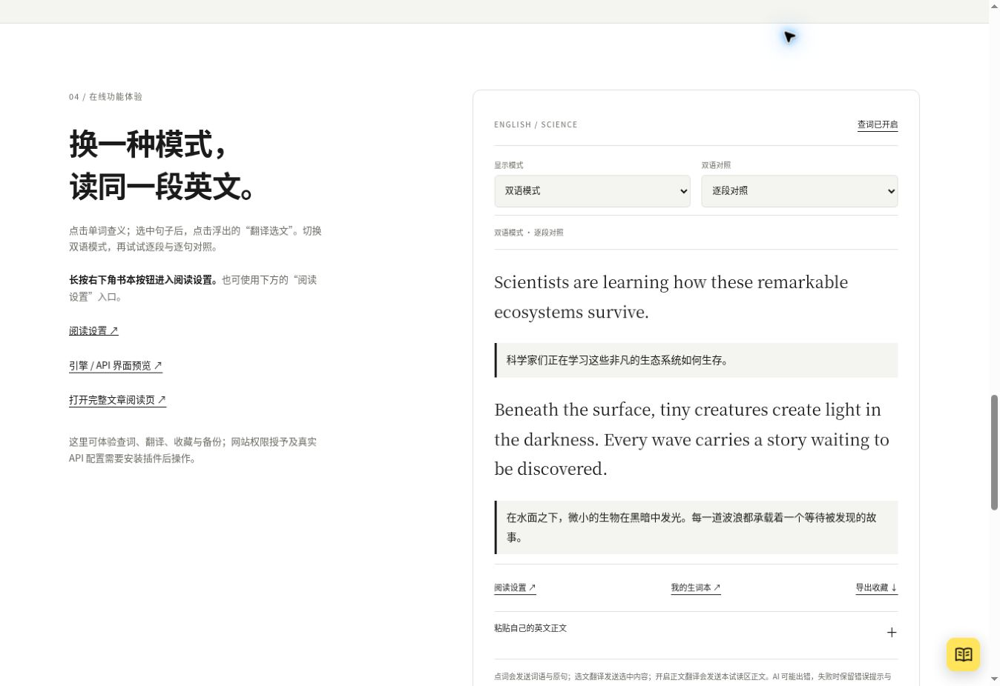
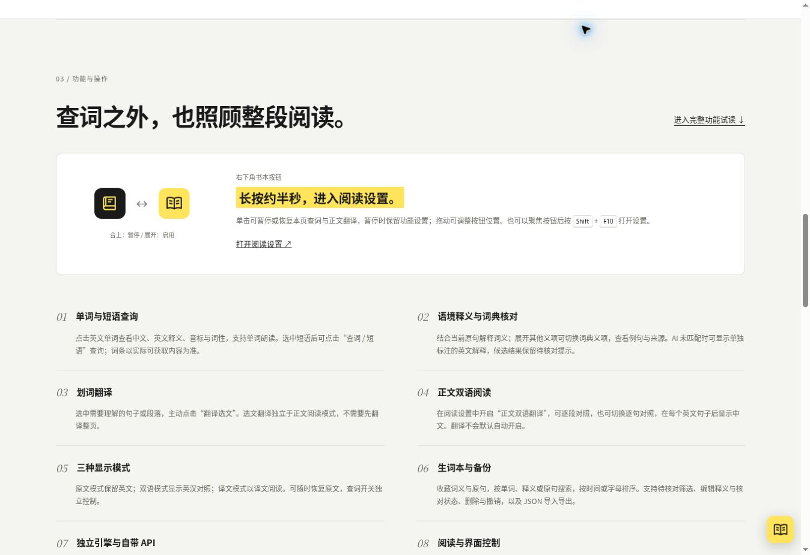

# 语境精读 · Closeread

为英语学习者设计的网页精读插件

**读懂单词在原句中的含义。**

点击英文单词，结合当前原句查看中文含义与英文释义，展开词典义项核对用法。支持划词翻译、网页双语阅读，并可将这次词义连同原句收藏。

[下载安装](#安装与体验) · [在线体验](https://52def8aa.lextide.pages.dev/product.html#experience) · [完整功能](#完整功能) · [使用方法](#开始使用) · [隐私说明](docs/PRIVACY.md)



*当前网页预览的实际界面，公开安装服务已提供 0.8.0 用户脚本试用版。界面示例来自真实服务返回，不代表全面语义准确性或原生安装验收。*

## 为什么使用语境精读

整页翻译适合快速了解大意。当你想继续读英文原文、弄清某个词在这句话中的具体用法时，语境精读提供词语层面的解释与核对依据。

- **结合当前原句查义**：先看中文，再对照英文解释，减少在多个释义之间来回查找。
- **保留词典依据**：展开其他义项、例句和来源，自行核对 AI 的判断。
- **按需要获得帮助**：可以只查一个词、翻译选中的一段，或开启网页双语阅读。

## 安装与体验

| 使用方式 | 适用场景 | 入口 |
| --- | --- | --- |
| 浏览器扩展 | 桌面 Chrome、Edge 等 Chromium 浏览器，开发者模式加载 | [安装与构建](docs/INSTALL.md) |
| 用户脚本 | 通过 Tampermonkey 等脚本管理器试用 | [公开安装页](https://click-context-install.aa1986884.workers.dev/) · [脚本说明](userscript/README.zh-CN.md) |
| 在线体验 | 无需安装，体验查词、双语阅读、选文翻译与收藏 | [直接体验](https://52def8aa.lextide.pages.dev/product.html#experience) |

> 截至 2026-10-29，0.8.0 源码已合并 main，公开安装服务已提供 0.8.0 用户脚本试用版（来源提交 f4264c2）。GitHub 尚无 Release；这不代表稳定版、原生扩展或移动端验收通过。 下载时请核对[版本信息](https://click-context-install.aa1986884.workers.dev/release.json)，详见[发布状态](docs/RELEASE_STATUS.zh-CN.md)。

## 开始使用

1. 在浏览器工具栏启用当前网页；按需要记住网站设置。
2. 点击英文单词，查看语境释义、词性、英文解释和原句；展开其他义项可切换词典释义。
3. **长按右下角书本约半秒，进入阅读设置**，开启“正文双语翻译”，选择逐段或逐句对照。
4. 按需将词义连同原句收藏，在生词本中搜索、编辑或导出备份。

| 操作 | 效果 |
| --- | --- |
| 单击书本 | 暂停 / 恢复本页查词与正文翻译，保留功能设置 |
| 长按约半秒 | 进入阅读设置 |
| 拖动书本 | 调整悬浮按钮位置 |
| 聚焦按钮后按 Shift + F10 | 使用键盘打开阅读设置 |
| 拖动 / 收起词卡 | 调整小窗位置，或收起后继续阅读 |

书本合上表示暂停，展开表示启用。查词开启时，正文英文链接优先用于查询；关闭查词后恢复正常跳转。



## 完整功能

| 功能 | 可以做什么 |
| --- | --- |
| 单词与短语 | 点击单词或划选短语查询；显示音标、词性，支持单词朗读。词条以实际获取结果为准 |
| 语境释义 | 结合当前原句解释词义；匹配时使用词典义项，未匹配时可显示单独标注的 AI 英文解释 |
| 词典对照 | 切换其他义项、查看完整英文解释、例句与来源；AI 候选保留待核对提示 |
| 划词翻译 | 选中句子或段落，主动点击“翻译选文”，无需先翻译整页 |
| 网页双语阅读 | 逐段英汉对照，或每个英文句子后显示中文；由用户单独开启 |
| 三种显示模式 | 原文、双语、译文模式切换，可恢复英文原文 |
| 本地生词本 | 保存词义与原句；搜索、排序、待核对筛选、编辑释义与核对状态、删除与撤销 |
| 备份与迁移 | JSON 导入与导出；卸载或更换浏览器前可自行备份 |
| 引擎与自带 API | 正文、选文翻译分别选择引擎，语境 AI 设置独立；真实配置在插件中完成 |
| 阅读控制 | 词卡与按钮拖动、收起和位置重置；失败重试、缓存清理、深色外观，扩展按网站启用 |

网页中的 API 设置页为不保存密钥的界面演示。真实服务可用性取决于凭据、模型、权限和网络，未宣称所有厂商 API 均已实测通过。

## 隐私与结果来源

- 词典查询发送所查词语；语境分析发送当前原句及定位等必要信息。
- 选文翻译发送所选内容；正文翻译开启后，将待翻译正文发送至所选服务。
- 生词和设置保存在浏览器或脚本管理器的本地存储中，没有插件自己的云端生词同步。卸载前请导出备份。
- AI 可能判断错误。AI 生成内容单独标注，不作为词典原文；不确定时请对照原句和来源核对。
- Collins 内容读取自有道公开词条栏目，不是获授权的 Collins 官方 API。

[完整隐私说明](docs/PRIVACY.md) · [权限说明](docs/PERMISSIONS.md) · [第三方许可](docs/LICENSES.md)

## 开发与贡献

需要 Node.js 22+。在源码目录执行：

```sh
npm ci
npm test
npm run check
npm run build
```

扩展目录为 `build/extension/`，通过开发者模式加载。用户脚本执行 `npm run build:userscript`，产物为 `build/userscript/click-context.user.js`。更多构建与验证方式见[测试说明](docs/TESTING.md)。

欢迎反馈原句提取错误、词义偏差、无法点词的网页或界面问题。请附浏览器版本和不含隐私的复现示例，不要提交 API 密钥。

[贡献指南](CONTRIBUTING.md) · [反馈问题](https://github.com/a1986884/closeread/issues) · [安全说明](SECURITY.md) · [MIT 许可证](LICENSE)

## 文档与版本记录

[安装说明](docs/INSTALL.md) · [引擎与 API](docs/TRANSLATION_ENGINES.zh-CN.md) · [版本记录](CHANGELOG.md) · [界面规范](docs/UI_DESIGN.zh-CN.md)

<details>
<summary>更名、历史版本与验证范围</summary>

原项目名 Lextide / 词汐，0.7.88 起使用“点击语境查词”；0.8.0 展示名改为“语境精读 / Closeread”。旧存储键与内部标识保留，已有生词与设置无需迁移。

0.7.161 用户脚本与 0.7.98 原生版本是本次之前的两个独立版本；本次代码版本统一进入 0.8.0 候选，不会改写历史发布包。公开安装服务已提供 0.8.0 试用版，历史发布包保留原状。AI 语义准确性仍有未解决情况，Safari、iPhone 和真实脚本管理器未在本轮验收。

原 README 的全部版本状态、测试数量、诊断链接与历史交接内容保存在[改版前 README](docs/legacy/README-before-0.8.md)，逐轮记录保留在[历史迭代](docs/ITERATIONS.md)和[诊断目录](docs/diagnostics/)。对应 GitHub Actions 是否通过，以该提交的实际运行结果为准。

</details>
