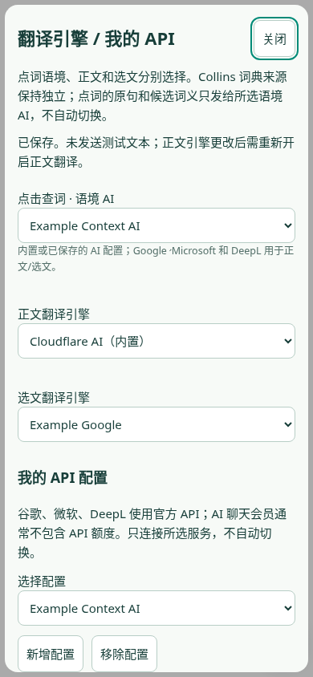
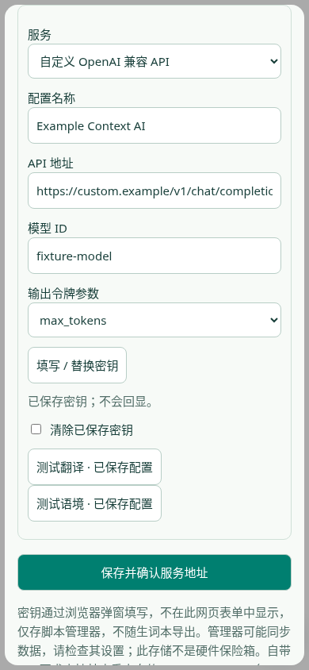

# 点击语境查词：0.7.129 用户脚本开发版

**0.7.129 本地回归通过，真实内置服务503失败，仅为未验收候选，尚未上传公开安装地址。** 可直接导入本包脚本试用，公开入口仍110；无真实厂商API、原生管理器或iPhone验收。

本版在独立分支基于插件 0.7.98 制作，主要交付用户脚本；共享词卡的容错修复同时留在源码中。原插件版本与线上预览保持不变；AI 后台新增独立的用户脚本公开接口；0.7.104 起提供独立的公开脚本安装地址；不发布用户配置或密钥。

构建：`npm ci --ignore-scripts`，`npm run build:userscript`，产物 `build/userscript/click-context.user.js` 及安装说明。该文件无需外部脚本依赖；包含 MIT 许可证，不含密钥。

## 当前功能

- 复用词典卡、Collins 来源、按原句选义、同义直接选择词典义项、AI 失败标记与重试。
- 点词、短语查询、主动选文翻译；设置内正文逐段/逐句双语、原文恢复和取消请求。
- GM 管理器存储：收藏跨网站共享，界面偏好按网站区分。不会读取或修改原插件数据。收藏可从生词本导出备份。
- 每次页面加载关闭查词与正文翻译，首次展示联网说明，以后仅显示关闭状态浮标。开启查词后，英文正文链接用于查词；关闭恢复正常链接。
- 支持点击语境、正文、选文三项独立选择。17 个预设与自定义 API 配置；点击语境可选已保存的 AI 配置，Google/Microsoft/DeepL 用于正文和选文。默认仍为内置语境；用户 API 请求直达所选服务，不经内置 AI 转发。

## 安装与兼容性

在脚本管理器中导入 `.user.js`，或新建脚本并以文件完整内容替换示例。需具备 GM 存储及 GM 跨域请求接口，兼容旧式函数与现代 GM 对象两种 API。

iPhone 要求 iOS / Safari 17.4+。安装兼容的 Safari 脚本管理器，并在 Safari 扩展设置里授权测试网页。普通英文网页出现浮标后点击开启，首次也可在阅读设置勾选“查词”。长按浮标打开设置，系统选择英文后点“翻译选文”。仅下载文件不等于已经安装脚本。

尚未在 iPhone 或 Tampermonkey 本机安装验收。普通浏览器模拟 GM 验证不等于实际管理器通过；不保证所有管理器的 API、跨域行为及权限弹窗一致。内置 AI 使用 /userscript/meaning 与 /userscript/translate 匿名公开接口，允许原网页及 Safari 管理器来源，不发送凭证、不伪造来源。旧 /meaning 和 /translate 保留来源限制；新旧接口共享原有额度、校验和超时。默认只向有道词条、现有 Cloudflare AI 和预览词条 API 三个主机发请求；为支持自定义 API 声明 @connect *，代码对用户 API 额外限制为已保存并确认的精确 Origin（含端口），不允许任意网页指定目标，不绕过管理策略或网站验证。

## 验证及已知限制

- `npm test`：包含原有合同测试与新增适配器测试。
- `npm run test:userscript`：对真正生成的脚本，以两类模拟 GM 接口验证 390px 触摸点词、义项、收藏、选文主动发送、正文翻译、原文节点恢复和重新加载默认关闭。
- `npm run test:userscript-live`：普通 Chromium 使用 curl 转接的 GM 模拟请求，访问真实词条及 AI，不是脚本管理器安装。当前验证用户反馈的 class 原句；旧 0.7.99 仅验证 bank 样例，不能视为广泛准确率或 iPhone 通过。
- 首轮真实网络三次均 HTTP 200，但检查只接受“河岸”，将正确 Collins“岸”误判。原失败报告保留为 `userscript-live-initial-report.json`；修正为同时检查当前中文词义含“岸”、展示义项包含 river 后重新验证。
- 直接 Node fetch 在当前环境 DNS/连接失败，curl 公开请求可达；实际手机的网络情况仍需试用。服务可能限流、不可达或翻译失败；正文 NaCl 等既有问题没有在本版解决。
- 只支持普通 HTML 顶层页面，不支持内部页、PDF 查看器或跨域 iframe；已排除线上预览域名，避免重复词卡。脚本管理器可能同步 GM 数据，是否同步由管理器设置决定。
- GM 存储不提供本脚本可用的跨标签页事务；同时在多个页面修改生词有竞争风险，试用期间建议单页收藏并及时导出。

后续优先根据实际 iPhone 安装反馈解决管理器差异，再完善 API 配置的真机兼容性；不把网页预览当安装成功。

## 0.7.100 修复

用户反馈的 `This class is co-taught by Anish, Jon, and Jose.` 暴露旧服务拒绝普通网页 Origin 的兼容性问题。旧端点真实 Origin 测试 HTTP 403，新接口红测先失败，再修复。不能据此断言手机请求实际带的 Origin 值；尚无手机网络日志。

- 兼容管理器返回跨 JavaScript 环境 ArrayBuffer、typed array 与纯文本的响应。
- 词条页面没有可解析 Collins 栏目时，只额外向已有预览词条 API 查询一次同一公开来源；直接源 HTTP 401/403/429、网络异常不触发此路径，不绕过拒绝或验证。
- 缺词条显示真实读取原因，不再错误称为“演示条目”或“示例释义”；无对应词典义项的成功结果继续明确标 AI。
- 新增 class 普通浏览器场景：栏目缺失、词典缺失但 AI 成功、两服务失败、词典拒绝时不转发。
- 旧 0.7.99 报告保留在旧发布包；本轮红测与初始 UI 测试错误单独保留。新版本不冒用旧报告通过。

升级时替换旧脚本内容或导入新文件，禁用重复旧脚本，然后刷新原网页；可能需要允许新增的 v04-preview.lextide.pages.dev 主机。原生 iPhone / Safari 脚本管理器安装仍须由用户试验。

## 0.7.101 API 与独立引擎

长按浮标或使用脚本管理器“引擎 / 我的 API”菜单。新增 Google Cloud Translation、Microsoft Translator、DeepL、OpenAI Chat/Responses、Claude、Gemini、DeepSeek、Qwen、Kimi、GLM、豆包、Grok、PLaMo、硅基流动、Ollama 和自定义 OpenAI 兼容配置；需填写账号实际可用的模型 ID，聊天会员不等于 API 额度。Ollama 的 localhost 指当前设备，iPhone 不是你的电脑。

密钥通过浏览器原生 prompt 输入，留在用户脚本闭包与 GM 存储；封闭 Shadow DOM 的设置界面只持有无密钥的配置视图，不回显保存的密钥。不会写网页 localStorage，不随生词导出。GM 数据是否云同步由管理器决定。仅在支持隔离 GM API 的管理器里安装可信脚本，脚本存储不是硬件保险箱。

按 Tampermonkey 当前文档 https://www.tampermonkey.net/documentation.php?q=GM_xmlhttpRequest ，redirect:error 从 build 6180+ 支持并强制 fetch 模式。为避免无法确认的管理器在 API 重定向时转发密钥，仅在 GM_info/GM.info 确认为 Tampermonkey build 6180+（或 5.6+）启用自带 API；其他管理器仍可使用内置服务。实际管理器接口遵循文档的情况仍待真机验收。

所有用户 API 请求匿名、redirect:error；精确 Origin 白名单、响应大小和超时校验、取消请求、返回值脱敏沿用已有翻译执行器。不伪造 Origin，不绕过管理策略。只在新增服务 Origin 时确认一次；更换地址到不同 Origin 需重新填密钥。改配置隔离缓存；更换正文引擎时先恢复原文并暂停正文翻译，保存与改选不会自动发送文本；只有重新开启翻译或主动点测试才发送。已有服务的引擎切换不反复询问主机授权。

配置读取失败不会重置旧密钥或悄悄回退内置翻译；查词仍可用。401/403、限流和失败不切换其他服务。尚无用户真实厂商 API 凭据，本轮自带 API 仅进行合成响应/密钥测试，不能称各家实测通过。内置服务另跑当前脚本真实 class 原句样例，不冒用旧报告。

## 0.7.102 连接检查

长按浮标后点“连接检查 / 诊断”，或从脚本管理器菜单进入。显示经过白名单筛选的管理器名称、版本和自带 API 重定向支持情况；不读取已保存 API 配置。打开界面不联网，主动“检查内置连接”才发出三项固定请求：两次空 JSON 探测语境/翻译接口（预期 HTTP 400，验证请求校验链路可达，不调用模型），一次公开 class 词条请求。既不采集网页原文、完整 URL、标题，也不发送用户 API 密钥；浏览器/管理器自身的请求元数据不由脚本伪造。

结果区分拒绝、限流、网络错误、词典义项不可用和异常响应。复制诊断只含固定字段与归类状态，不含原始服务响应、阅读内容、网址、配置名称或密钥。剪贴板不可用时可手动复制文本。关闭取消所有探测，重复点击合并，重新打开显示上次结果，不自动复测或轮询。检查接口可达不能证明翻译准确或已通过原生安装。

统一用户脚本版本来源至 version.js；构建、界面和新测试报告引用同一个版本。当前 API、Collins 来源、AI 标识、双语原文恢复和生词本行为保持。本轮不修改 Worker 或线上预览。

验证：559 项单元/契约、五组生成脚本普通浏览器测试通过；当前生成文件的真实 class 原句仍匹配“课程”，选文译文保留三个人名与共同授课关系，另三项公开连接探测均可达。仍未实测用户厂商凭据或 iPhone / Tampermonkey 原生安装；不把旧报告当本版通过。

## 0.7.103 弹窗与配置恢复

修复管理器未提供 prompt/confirm 时 API 设置初始化抛错、导致查词菜单注册失败的问题。先在 0.7.102 生成文件上复现失败（dialogs-red），再修复：没有弹窗只禁用相应配置步骤，不把密钥改放网页输入框，内置查词和翻译继续可用。连接诊断增加是否提供密钥/确认弹窗函数的布尔值，不包含输入内容；仅表示函数存在，不代表真机操作成功。

异步密钥输入结果绑定配置 ID、精确 API Origin 和当前界面会话；更改目标 Origin 要重填，关闭/重开或改变配置后迟到结果丢弃。等待输入期间禁止保存，不回显或持久化密钥草稿。已保存密钥的旧行为保持。

配置读取按序执行，界面关闭后迟到读取不重新显示或写入草稿。保存前检查公开 revision（引擎选择及随机配置修订标识），发现其他页面已经更新则拒绝覆盖；不在 revision 中放密钥。此检查降低旧界面覆盖风险，不是跨页面原子事务，仍建议避免多页同时编辑。

增加请求取消测试：改正文引擎取消旧正文请求并忽略迟到结果；只改选文引擎不取消无关正文请求。562 项单元/契约、六组普通浏览器测试通过；内置 class 原句和连接检查另用当前文件真实联网验证。厂商凭据、原生 Tampermonkey/iPhone 未验收。本轮 AI 后台与网页预览保持不变。初轮取消测试的存储夹具参数错误记录单独保留，修正夹具后通过，不声称是产品错误。

## 0.7.104 固定安装地址

安装页：https://click-context-install.aa1986884.workers.dev/

脚本：https://click-context-install.aa1986884.workers.dev/click-context.user.js

更新元数据：https://click-context-install.aa1986884.workers.dev/click-context.meta.js

新增独立静态安装 Worker，仅 GET/HEAD 提供安装页、当前脚本、元数据、版本 JSON 和 MIT 许可证。页面无 JavaScript、表单、外部图片或追踪，不接收密钥，不代理 API，不绑定 AI 或用户存储，关闭观测日志。现有预览站、AI Worker 及其限流保持不变。

脚本沿用名称、namespace 和 GM 存储键；加入 homepageURL/updateURL/downloadURL，排除安装页自身以免重复浮标。管理器决定是否检查或自动更新，脚本自身不轮询。手机若只显示代码，请用管理器导入脚本。升级前可导出生词备份；若出现重复条目，请保留原数据并禁用重复脚本。没有绕过 Safari 或浏览器管理策略，也未上传 Greasy Fork 或 GitHub。

本轮：565 项单元/契约、七组普通浏览器套件，本地安装页 390/1280 布局、脚本/元数据字节与响应头校验；当前脚本的内置 class 原句及诊断另做真实联网。线上验收独立核对 Worker 内容哈希、安装页版本、下载脚本 SHA256 和元数据，不把本地报告视为线上通过，也不把线上文件可下载当 iPhone 安装通过。真实用户厂商 API、Tampermonkey/iPhone 原生安装仍待验证。

## 0.7.105 词典失败时继续语境释义

先在 0.7.104 生成文件复现：单词 class 的 Collins 请求被拒绝后，独立语境接口没有收到请求。红测保留原版本号和失败结果，修复后用 0.7.105 重新构建验证。

现在用户主动点词、有原句且查询有效时，词典拒绝（403）、限流（429）或网络失败不再阻断独立 AI 语境请求。词典请求不会切换入口规避拒绝，不自动重试，不增加轮询；没有原句、无效词和明确的联网授权错误不触发这条路径。现有请求取消、关闭词卡、切换单词和刷新序号保护保持。

AI 成功时明确标为“AI · 语境释义”，保留 Collins 读取失败原因及已有的合法来源链接；不伪装为 Collins，不再在没有词条时提示“下方词条仅供查阅”。两边都失败仍显示语境错误、词典原因和手动重试。Collins 正常且 AI 释义与原义一致时仍直接展示该词典义项。正文/选文独立引擎、自带 API、双语开关及恢复原文不变。

本轮 569 项单元/契约、生成脚本普通浏览器回归、7 个 class 词典失败/缺失场景和桌面/手机宽度的语境失败恢复回归通过。首次全量测试中，旧点击覆盖夹具把新增语境调用也计为词典调用；已改为明确核对 lookup/context 两类调用并保留初始失败记录。当前生成脚本真实请求中 class 匹配“课程”，选文译文为“这门课由 Anish、Jon 和 Jose 共同授课。”；这只是该样例结果，不是广泛准确率结论。

通过已有静态安装地址发布；源码包和脚本包均单独构建验证。AI Worker、旧预览站与原生插件 0.7.98 不发布变更。普通 Chromium + 模拟 GM 不等于 Tampermonkey 或 iPhone 原生安装验收；真实厂商 API、科学文本 NaCl 和 bass 修饰语问题仍未解决。

## 0.7.106 分开检查直接词典来源

先红测复现旧版误判：备用词条接口成功时，即使有道公开 Collins 直接来源拒绝访问，旧诊断也会报告全部可达。现在显式检查两条词典链路并分别显示结果，共四项固定请求（语境、翻译、直接词条、备用词条），不会因为直接来源失败而额外重试或改走其他地址。

直接来源 HTTP 200 还要通过现有 Collins 抽取器，确认词头为固定探测词 class 且存在可用义项；验证页、栏目缺失或其他词头不能标成成功。报告只记录状态、HTTP 状态码及义项数量，不复制网页 HTML、服务错误原文、API 配置或密钥。该固定单词探测不能代表所有词条可读。

打开界面不联网，重复点击合并，关闭取消四项请求，重开显示上次结果，不轮询、不自动复查。备用接口成功也不掩盖直接来源的拒绝、限流或解析失败。词卡、独立引擎、AI 来源与原文恢复不变。

本轮 571 项单元/契约及普通浏览器回归通过，包含“直接来源 403、备用成功”的分项报告和 HTTP 200 无效词条场景；当前生成脚本另作真实 class 原句、选文和四项诊断验证。发布固定安装地址并验证线上下载哈希，源码独立重建。AI Worker 与旧预览不改动；未完成 iPhone / Tampermonkey 真机安装和真实厂商凭据验收，NaCl 与 bass 既有问题仍待改进。

## 0.7.107 缺词条缓存与手动恢复

红测在 0.7.106 生成脚本复现：备用词条响应为 kind:unavailable、senses:[] 但缺少 partial 标志时，会被共享词典缓存当成完整条目保留。用户点“重试”也只能得到旧的缺词条结果；语境可以恢复，但 Collins 义项仍缺失。

缓存现在同时检查 kind 和显式 senses 数组：不可用条目、空义项和原有 partial:true 均不缓存；读取时清除旧缓存中的此类结果。完整词条继续保留原有 TTL/LRU、大小写复用、独立取消、并发合并与词条复制隔离。失败后不自动重试、不轮询；下一次用户主动重试或重新点词才读取来源。未调整来源权限或转发规则。

本轮新增合同覆盖缺失 partial、旧无效缓存清理、并发缺词条合并与成功缓存；生成脚本覆盖“词典和语境失败 → 服务恢复 → 手动重试取得 Collins 课程义项”的完整流程。574 项单元/契约、普通浏览器回归和语境失败恢复通过；当前脚本另跑真实 class 原句、选文和四项连接检查，不复用旧报告。

首次绿测的浏览器夹具误将恢复场景放入“拒绝来源”计数列表，造成 6 请求误与 2 请求比较；已纠正夹具并保留该初始失败，不能据此声称产品仍有相同错误。先前红测保留旧脚本 0.7.106 的 4 次请求与预期 6 次请求差异。

固定安装地址更新并核对线上脚本哈希；提交、源码 ZIP、历史包、独立源码重建及交付包校验分别留证。AI 后台与旧预览未修改。真机安装、真实厂商 API、科学文本 NaCl 和 bass 修饰语问题仍未解决，不把普通浏览器通过当作这些项目已验收。

## 0.7.108 管理器不回调时的超时兜底

先红测复现旧适配器只依赖管理器 timeout/ontimeout 的缺口：模拟管理器一直不回调，请求会保持 pending。修复后，每个 GM 请求都有本地 25 秒超时兜底，并继续向管理器传入原有 25 秒限制；上层较短的取消/超时仍优先。浏览器后台暂停或计时器节流可能推迟本地回调，不承诺后台绝对墙钟时限。

超时后只终结一次并尝试取消管理器请求；取消句柄抛错不会掩盖超时或造成未处理异常。关闭与主动取消同样终结请求并清理计时器。成功、错误和取消均清理超时监听；迟到响应不再解码或覆盖结果。同步超大进度回调发生在取消句柄返回前时，返回后补做取消。没有重试循环、轮询、新增主机或凭证传递。

连接检查单独显示“请求超时，请重试”，报告只含固定 timeout 状态，不复制管理器错误。普通浏览器虚拟时钟场景模拟四个管理器请求全部不回调，推进 25 秒后均超时并各取消一次；迟到回调被忽略，用户再点检查可恢复。此为模拟管理器行为，不是 Safari/Tampermonkey 真机结论。

本轮 578 项单元/契约与生成脚本普通浏览器回归通过，当前生成文件另作真实 class 原句、选文及四项诊断验证；源码独立重建、公开安装地址下载哈希和交付包校验分别留证。Collins 来源、AI 标识、独立正文/选文引擎、API 私密输入和原文恢复保持。AI 后台与旧预览未变；真机安装、真实厂商 API、NaCl 与 bass 既有问题继续列为未解决。

## 0.7.109 重复点词共用正在进行的查询

红测复现：同一目标、单词、原句和偏移的连续点击会取消前次查询并重发，即使仍在等待同一份词典或语境结果。现在只在这些条件完全一致、词卡仍打开、查询未取消且尚无重试错误时共用进行中的查询；不会清空词卡或重置已进行的工作。

词典阶段和 AI 阶段分别以普通浏览器真实生成脚本验证：重复点词不增加请求、不取消已有请求。不同目标、句子或偏移仍重新查询；关闭、关闭后重开、手动选义和失败后重试保持原有保护。收藏状态读取未结束时出现错误，点重试也不会误被合并。已完成查询不参与本次合并，成功结果缓存沿用现有规则。不增加轮询或后台预取。

本轮 582 项单元/契约、生成脚本普通浏览器回归，以及手动选义/同义展示专项通过；当前生成脚本的真实 class 样例匹配“课程”，选文译文保留共同授课关系与人名。该轮选文实际网络请求耗时约 14.1 秒，服务延迟仍会波动，不能把减少重复请求称为模型推理提速。

提交、固定安装地址、线上下载哈希与独立源码重建分别留证。AI Worker、旧预览、原生插件发布版本未修改。iPhone / Tampermonkey 安装、真实厂商 API 凭据和既有 NaCl / bass 语义问题仍未验收或未解决。

## 0.7.110 API 配置读取卡住时保留查词

单元红测和 0.7.109 生成脚本的普通浏览器红测复现：脚本先等待 GM 引擎配置读取，管理器不返回时，整个查词界面和菜单都无法启动。

现在仅为引擎配置读取设置本地 3 秒超时；失败沿用“配置无法读取”保护状态，不写默认配置、不删除密钥、不悄悄改用内置翻译，也不发送待翻译文本。查词与独立语境服务仍可启动。用户在管理器恢复后重新打开引擎设置，会重新读取并同步当前配置；保存仍是明确操作。迟到的旧读取不提交状态，不覆盖之后读到或保存的新选择。不自动重试或轮询，浏览器后台节流仍可能延迟本地计时回调。

不对写操作做超时竞速，因为底层写入不能可靠取消，迟到写入可能改变真实存储。本轮修复限于可选的引擎配置读取；若管理器所有存储操作都无法完成，不能据此保证启动或保存可用。

新增生成脚本普通浏览器场景：私有配置读取不返回、查词恢复、翻译被阻止、旧密钥保持、恢复后手动保存及迟到读取隔离。自带 API 仍仅用合成密钥验证；没有访问真实厂商账户。初轮绿测夹具只赋值引擎下拉框、未触发 change 事件，导致恢复用例未真正改选内置；已修正交互并保留初始失败记录。

本轮 584 项单元/契约、包含新存储场景的普通浏览器套件通过；当前生成文件另验证真实 class 原句、选文和四项诊断。固定安装地址与下载哈希、源码独立重建及交付包校验分别留证。AI Worker、旧预览与原生插件发布版本保持。真机安装、真实厂商 API、NaCl / bass 质量问题和服务延迟波动仍未解决，不以单一 class 样例代表整体准确率。

## 0.7.112 页面离开时可靠清理

从 0.7.110 稳定基线加入页面生命周期修复：首次网络说明的 GM 读取或写入一直不返回时，旧脚本尚未注册 pagehide 监听，离开页面不会取消正在等待的词典或语境请求。普通 Chromium 与模拟 GM 的四个场景先红测复现；提前注册清理监听后，测试再次拦住迟到读取重新弹出说明的问题。现在离开页面即取消当前请求、恢复原文并关闭设置；迟到读取不再弹窗，也不将未展示说明标为已展示。未取消或竞速底层存储写入，没有新增轮询。

页面返回不会自动联网；用户可重新点词。保留已有 Collins 来源、AI 语境释义、同义匹配展示、正文/选文独立引擎、自带 API 私密输入及原文恢复。此版本沿用稳定线 ai-context-v3 与翻译 v4；0.7.111 的新语境 v4 / 翻译 v5 继续留在候选线，真实质量总报告失败，未混入稳定脚本。已部署后台同时接受旧修订，112 不改动 AI Worker、旧预览或原生插件版本。

0.7.111 候选的两轮真实测试分别出现 baby 语境、旧翻译 v4 和新翻译 v5 的 16 秒超时；缩小模型的有限探针有误义，均未采用。其源码、失败记录和 91 项包内校验留在 ClickContext_0.7.111_Userscript_Candidate.zip，不能据此称科学文本或整体可用性通过。112 的普通浏览器生命周期回归不等于 Tampermonkey 原生安装、iPhone 或真实厂商 API 验收。

112 验证结果：584 项单元/契约、全部普通浏览器用户脚本套件和四个新增生命周期场景通过。当前实际生成脚本的真实 class 原句得到“课程”，选文保留共同授课关系和三个人名，四项内置连接诊断通过；这只是有限样例，不代表整体准确率。来源、语境与翻译模块同稳定 110；没有重新跑 111 的 24 语境/9 科学文本，也不沿用这些报告冒充 112 通过。

发布因 Cloudflare 连接认证过期受阻，未读取备用凭据或尝试绕过连接。公开 HTTPS 下载核对为 0.7.110 及其原脚本哈希；后台只读取公开 health，不能据此验证当前模块哈希或管理设置。完整 110 安装 Worker 回滚模块与历史已核验哈希一致，但没有本轮管理接口读回证明，不称为新鲜线上快照。默认发布打包仍要求当前版本线上报告与部署证明；本地交付必须显式 `--unpublished`，文件名和元数据都注明未发布。源码独立重建与所有包内文件另行核对。服务波动、既有科学文本问题、真实厂商 API、Tampermonkey 安装和 iPhone 验收继续保留为未解决或未验收项。

## 0.7.113 首次提示的存储错误不误报启动失败

旧脚本已注册菜单并可用，但读取或写入“首次提示已展示”标记报错时，最外层异常处理仍会弹出“未能启动”。实际 112 生成文件在旧 GM 同步抛错、现代 GM Promise 拒绝的读/写四场景均先红测复现。现在只隔离这一可选标记的读取与写入异常；真实初始化错误仍由原处理报告。读取失败不猜测已保存值，不写入或重置标记，也不自动联网；网络说明始终可从阅读设置查看。写入失败不重试，避免底层可能已完成的操作被重复提交。

不增加计时器或轮询。每页查词和正文仍默认关闭；手动查词、离开页面取消请求、原文恢复、返回后手动再查与 112 的迟到提示保护均有普通浏览器场景验证。保持稳定线词典、语境、翻译引擎和 API 配置行为；未合入 111 未通过真实质量验收的模型候选。Cloudflare 最近一次连接要求重新认证；本轮继续做本地交付，线上版本须另行读回验证后才能称为发布完成。

113 本轮 584 项单元/契约、全部普通浏览器脚本套件、四项首次提示错误场景和四项生命周期场景通过。当前生成脚本另完成真实 class 原句、选文和四项连接诊断；class 为“课程”，选文保留共同授课与三个人名。未复用 112 的脚本报告；也没有重新跑或宣称通过 111 的模型质量套件。公开 HTTPS 脚本本轮仍核对为 110，管理连接最近一次要求重认证，未再次尝试写入或读取其他凭据。113 交付包明确标为 Unpublished；厂商真实 API、原生脚本管理器安装、iPhone 与服务可用性仍未验收或未解决。

## 0.7.114 菜单面板切换与检查取消

113 实际生成脚本的六个普通浏览器场景先红测：从脚本菜单切换引擎设置、连接检查、阅读设置或生词本会叠出两个界面；离开正在进行的连接检查或 API 测试也没有取消原请求。现在引擎设置和连接检查在实际打开前关闭另一弹窗；阅读设置和生词本的菜单入口关闭这两个弹窗。引擎仍在保存或测试、原逻辑不允许打开时，不会先关闭另一界面。

沿用原关闭逻辑：连接检查的四个请求全部取消；单项自带 API 测试取消一次；迟到回调不重开面板；再次打开引擎设置可恢复。打开或切换面板本身不发送文本，不保存 API 配置，也不增加重试或轮询。未保存编辑按原有关闭逻辑丢弃，已经提交的存储写入不做竞速或取消。测试只用合成密钥，不连接真实厂商账户。

本轮继续验证 112 的页面离开保护、113 的可选标记错误隔离和原有查词/翻译行为。模型与协议沿用稳定 110，111 的真实质量失败仍保留；本版不是科学文本、原生管理器或 iPhone 验收通过的声明。最近的管理连接要求重新认证，仍准备明确标为 Unpublished 的本地交付。

114 的 584 项单元/契约、包含六个新场景的完整普通浏览器套件通过；迟到回调与取消后的重新打开也有断言。当前生成脚本的真实 class 原句为“课程”，选文保留共同授课和三个人名，四项内置诊断通过。公开下载本轮仍为 110；管理连接没有重新认证，不发布稳定地址、不冒称线上或真机验收。本地包独立重建并核对文件哈希，已有服务超时、NaCl、真实 API 和 iPhone 限制继续保留。

打包前源码审计因测试中明确合成的占位密钥写法失败；已改为 EXAMPLE 前缀。旧完整 Git blob 与精确文件路径按现有历史夹具审核机制记录，未排除整个文件或放宽密钥模式。初始失败日志保留；该夹具只记录模拟 GM 请求，没有连接真实厂商或使用真实凭据。

## 0.7.115 迟到的首次提示不打断当前操作

实际 114 生成文件红测复现：首次提示标记读取较慢，用户已打开引擎设置、连接检查、生词本或阅读设置后，读取才返回“尚未展示”，自动提示会新增面板、切离生词本或重置表单焦点。六个操作场景失败；未操作的首次提示对照正常。

现在用户从脚本菜单打开界面，或在等待阶段发生指针/键盘交互后，不再自动展示迟到提示，也不标记为已经展示。未操作的首次用户仍正常看到联网说明并记录展示标记；阅读设置内说明始终保留。只记录交互发生与否，不读取或保存事件内容；临时监听在读取结束、首次交互或页面离开时移除。不增加计时器、重试、轮询或联网动作。保持 112 页面清理、113 存储异常隔离、114 面板切换及原有词卡和独立引擎行为。

七个普通浏览器场景包括菜单、鼠标、键盘及未操作对照，先红后绿；这不是原生脚本管理器或 iPhone 验收。模型协议继续沿用稳定 110，已有科学文本与服务超时限制不因界面修复而消失。最近的 Cloudflare 管理连接要求重认证，仍准备明确标为 Unpublished 的本地交付。

115 本轮 584 项单元/契约、完整普通浏览器套件及七个新场景通过；112—114 的生命周期、错误隔离和面板切换回归继续通过。当前生成脚本的真实 class 原句为“课程”，选文保留共同授课与三个人名，四项内置诊断通过。公开下载本轮仍核对为 110，管理接口没有重认证或写入；交付明确为未上传的本地包，源码独立重建与包内哈希另行核对。既有模型质量、服务可用性、真实厂商 API、原生管理器和 iPhone 的限制不变。

## 0.7.116 引擎与诊断弹窗的键盘焦点（真实验收未通过）

实际 115 生成文件在手机宽度、桌面和配置读取未完成的场景均先红测：从脚本菜单打开弹窗后，焦点仍留在网页按钮上。现在打开引擎设置或连接检查即聚焦可用的关闭按钮；Tab / Shift+Tab 在当前弹窗的可见、启用控件间循环；Esc 关闭后回到原焦点，原元素删除或隐藏则回到查词浮标。切换弹窗保留网页原焦点，不将焦点交还已经关闭的弹窗。页面离开时关闭不重新聚焦。

共有的小型焦点辅助模块只保留元素引用，不读取输入值。保持私密 API 弹窗与闭合 Shadow DOM、正在保存时的保护、异步提示序号和检查取消逻辑。不会因打开、关闭或按 Tab 发送文本；不增加轮询或计时器。配置读取卡住时仍可用键盘关闭，迟到失败不重开界面。

首轮较高视口通过后，390×480 的短视口又拦住“已聚焦但按钮在滚动区域外”的问题；改为允许弹窗内焦点滚动到可见位置，关闭后恢复网页焦点仍防止滚动。初始通过与短视口失败均保留，不能用桌面通过替代小屏通过。此为普通 Chromium 的键盘场景，不是原生 Tampermonkey、Safari 或 iPhone 验收。模型协议与已知服务/科学文本限制保持，管理连接待恢复，继续本地未发布交付。

116 额外红测发现点击弹窗背景后焦点回到网页，原根节点的 Esc 监听失效。键盘监听改为只在弹窗打开期间注册，关闭即移除；背景点击后 Esc 仍可关闭，网页暂时抢焦点后 Tab 可回到弹窗。保留 Ctrl / Alt / Meta 组合键。新增实现先前的通过记录与背景失败分开保留，不当作最终生成文件的通过证据。

116 最终当前脚本的 584 项单元/契约与完整普通浏览器套件通过，包括键盘、背景点击和外部焦点恢复。但本轮真实 class 原句误选“班”，选文和四项诊断通过，真实总报告为 failed。没有改宽“课程”断言，也没有重跑获取通过。此失败复现稳定语境 v3 的采样/语义问题；不能因 UI 通过而称整体查词通过。

本代只生成 Candidate 未验收交付包，默认稳定打包继续拒绝失败；必须显式 `--unpublished --candidate` 才允许保留失败的真实烟测，普通浏览器报告仍必须全部通过、版本及脚本哈希必须一致。包内列出失败报告与候选状态；源码独立重建及文件校验不代表语义验收。公开地址仍为 110，管理连接未恢复；下一代优先回到新语境修订的稳定性与对照词义测试。

## 0.7.117 新语境修订与完整真实质量回归

116 当前脚本再次把实际 co-taught 原句的 class 选成“班”，其失败报告与候选包完整保留，没有重跑碰通过。117 在保留 112—116 UI 修复的同时，接入 111 候选的新语境 v4（相同 GPT OSS 120B、temperature:0、一般性复合修饰语范围规则）与翻译 v5（相同 GLM 4.7 Flash、混合公式正文语言规则）；不写入 class 答案，不放宽“课程”断言。旧语境 v3 与翻译 v2/v3/v4 的提示词和行为仍由契约锁定。模型源文件来自已存档 111，当前源码重新构建 Worker 得到历史已核验的 7385b019… 模块哈希；这是源码一致性，不能冒充本轮线上模块读回。117 没有重新发布后台。

新的真实验收按顺序各运行一次基础操作、五个独立页面、24 语境、9 科学文本和 5 协议。各阶段独立执行，即使某阶段失败也继续其余阶段；任何失败仍令总报告 failed，不自动重试。每轮建立唯一目录，阶段日志和完整报告立即留档，运行期间先写本轮 running 标记，避免读取旧报告。打包核对完整阶段列表、脚本哈希、独立后台源码重建，并收录当前版本每轮快照；真实失败只能用显式未验收候选参数保留，不能通过普通打包。

bass speaker 的合理同义表达“低频音”根据既有未采用的 20B 探针记录加入测试词义检查，仍拒绝“扬声器/音箱”等未选中心词；鱼义仍拒绝误加“鳜鱼”。这些是测试词义检查，未向提示词嵌入回归词句。原句 class 的课程要求与对照含义保持。新增正负例验证检查器本身，避免合理表达被误判。

保持 Collins 来源、同义直接选择真实词典义项、独立正文/选文引擎、API 私密输入、原文恢复、页面清理、面板切换和键盘焦点。容量快拒绝只用于新修订，失败不缓存且保留词典与手动重试；这不能消除服务超时。近期管理连接要求重新认证，本轮不能宣称最新线上哈希；真实厂商 API、原生管理器和 iPhone 仍未验收。

117 本轮 603 项单元/契约与完整普通浏览器套件通过。一次预先固定的真实回归中，基础操作、五个独立页面、24 语境、9 科学文本与 5 协议全部通过；原句 class 的三个独立页面均为“课程”，“全班鼓掌”对照为“全班”。这不是重跑 116 获取通过；116 的错误与候选包保持。每阶段完整报告位于本轮唯一目录，打包收录快照并核对脚本及后台源码哈希。源码构建与 111 历史已核验后台模块一致，117 没有更新后台；本轮只读取公开 health，不能称最新线上模块哈希已读回。

人工复核已查看上述 29 个语境与 9 个科学样例。自动检查全部通过仍有措辞遗留：NaCl 译为“NaCl在0.9%时被加热……”的浓度关系表达生硬，数值、公式、负号和引用均保留，但不能称科学译文已完全打磨好。人工报告明确为 reviewed-with-follow-ups，交付元数据将自动结果与人工遗留分开记录；本轮不改提示词或反复重试来改写这份结果。

本代为 Unpublished 本地包。公开脚本本轮仍为 110；最近管理连接要求重认证，未再次尝试写入或读取备用凭据。原生发布/预览仍为 98，当前普通浏览器脚本验证不能替代原生管理器、Safari 或 iPhone 安装验收。真实厂商密钥未提供，API 仍仅以合成夹具验证。先前服务超时不因本轮全绿而视为消除。源码独立重建、包内哈希及完整历史另行留证。

117 首次打包仍依赖旧 scratch/live-class.log 路径，因本轮日志已迁入独立目录而失败；已改为直接收录本轮 basic.log，初始打包错误另存，不属于产品语义失败。产品和模型代码未变化，没有为打包修复重跑真实模型。

## 0.7.118 客户端中文数值符号与缓存隔离（验证中）

使用合成 Google / Microsoft / DeepL API 响应，先红测复现：原文 -2.0 / -3.5% 对应正确的“零下2.0 / 负3.5%”被误拒；正值对应同样中文负值反而可能通过。内置响应客户端也有这类漏检。本轮不声称真实厂商返回过这些错误，未使用真实厂商密钥。

现在只在客户端校验副本中归一化明确的中文负号和英语 negative / 一元 minus / below zero，原文请求和显示译文保持原样。已有数字、精度、条件和置信角色检查继续执行，二元减法、正负范围、负载及损失幅度表达保留既有行为。它是有限格式校验，不是完整数学或语义证明。未请求的开头 <think> 分析块不当作译文展示；原文自身包含此标签时仍作为字面数据处理。失败为不可自动重试，未显示或缓存失败结果，允许用户手动恢复。

实际 117 生成脚本在模拟 GM/API 中会把错误符号结果写入缓存；保存这份真实旧格式缓存夹具后，118 的初次浏览器回归又拦住“旧缓存绕过新校验”。内置缓存身份改为 v5:client-v2，自带 API 身份改为 en-zh:v3；默认存储和共享后台 IPC 同步使用客户端身份。旧记录仍保留，配置、密钥和 profile cacheRevision 不重置。内置请求协议仍为翻译 v5，没有向后台发送未部署的新版本。

27 个专项契约与四个生成脚本浏览器场景先红后绿：拦截符号反转、手动恢复、重新获取正确结果，并验证旧缓存与 API 配置保留、发送原文未改、请求没有自动重试或切换服务。只使用模拟响应；iPhone / Tampermonkey 安装和真实厂商账户未验收。

该改动属于客户端，重建后台源码仍为历史已核验的 7385b019…；没有更新后台。内置后台仍有原校验，不能宣称已解决后台在正确中文负号格式上的所有误拒。NaCl 浓度措辞、服务波动和管理连接重认证的遗留继续保留。正文/选文独立选择、Collins、AI 语境 v4、原文恢复及全部 UI 防护保持。

118 共享缓存默认身份与原生消息契约专项（模拟 Chrome API）已通过；这不是安装验收。源码构建清单补入新的客户端校验模块，避免选项页/弹窗运行时缺少依赖。另给 popup 普通浏览器报告补入实际打包文件指纹与 Git 来源，保留其原生版本标记 98，不把它改写为用户脚本 118 的原生通过记录。

118 最终 630 项单元/契约、完整用户脚本普通浏览器套件、四项数值符号与旧缓存场景、共享 popup 166 项回归通过。首轮单元测试 629/630，旧缓存身份断言未区分客户端与服务端；修正为分别检查 client-v2 与服务端 v5 后全部通过，初始失败日志保留，没有改动运行时代码来迎合旧断言。

当前脚本的五阶段真实检查各执行一次，基础操作、class 五页、24 语境、9 科学文本和 5 兼容协议均通过；人工复核 29 语境和 9 科学文本。本轮 NaCl 为“0.9%的NaCl被加热至-2.0°C；见图12和式(4)。”，比 117 浓度措辞自然，但后台提示没有改动，不能宣称普遍解决措辞波动。历史错误和超时保留；服务可用性、内置后台中文负号误拒、真实厂商账户与真机安装继续待验证。公开 HTTPS 仍为 110，管理认证最近在 112 失效后未重试，118 按 Unpublished 打包。

## 0.7.119 自带 AI 响应完整性

118 实际解码器在 15 个拒绝场景先红测：OpenAI 返回显式错误角色、refusal、工具/旧式函数调用或多个候选，Claude 文本混有工具、拒绝或未知块，Gemini 文本混有函数或媒体、多个候选或已阻止提示，都可能仍显示文本片段。现在要求完整可用的文本响应，遇到这些情况本地失败，不重试、不转发、不切换其他服务。保留兼容接口缺省可选 role 的行为、空可选工具列表，以及已知思考/脱敏思考块的隐藏；Gemini 文本签名仍为元数据。

十项正常与兼容响应对照保持通过；三个引擎的生成脚本失败后均可手动再试。使用 118 实际生成脚本捕获的模拟 GM 旧缓存，又复现旧缓存绕过新解析，修复前缓存场景仍失败。自带 API 缓存身份改为 en-zh:v4，旧记录不删除，profile cacheRevision/密钥/设置不重置；内置 v5:client-v2 与后台 v5 不变。只用合成响应与占位凭据，尚未代表真实厂商账户验收。

119 最终 656 项单元/契约、完整普通浏览器脚本套件与四个新增响应/缓存场景通过。五阶段真实服务各执行一次，基础、class 五页、24 语境、9 科学文本和 5 协议均通过；人工复核当前 29 语境及 9 科学译文。原句 class 三次为“课程”，鼓掌学生为“班级”，保持 AI 与 Collins 来源区分；近义时进一步收敛显示仍可改进。本轮 NaCl 浓度措辞可接受，不能据此抹去历史波动。

继续探查发现客户端旧有“损失/下降”数值例外过宽，会放过温度、压力最终值或另一数值的负号错误。仅用合成响应复现，未把它称为真实模型本轮出错；证据随包保留并列为下一代优先项。本版修复的是响应完整性，不能宣称数值语义校验完备。公开 HTTPS 仍核对 110，管理认证最近在 112 失效，本轮未重试管理操作；按 Unpublished 留档，真实厂商账户、原生管理器和 iPhone 安装未验收。

## 0.7.120 数值例外限定范围（真实服务未通过）

119 的“下降/损失”关键词例外太宽，13 个专项对照中七个错误符号场景先红测：下降到正温度、正压力，或同句另一数值的负号错误仍被放过。现在只有英文明确 loss/deficit 数额或 decrease/fall BY 变化量，并且中文明确是回报/收益或变化/变动时，才按同一数值、有限次数放宽负号表达。降到多少不等于负变化量；另一项温度/压力不继承例外。相同数值但不同角色也有反例。只规范校验副本，不改发送原文或显示译文。此为有限格式校验，不代替完整语义判断；不认识的合适表达仍可能被保守拒绝。

原有正确负温度、百分比、正负号、二元减法、普通损失译文继续回归。新增 18 项包括末尾小数标点和内置/自带引擎合同；生成脚本四场景检查拒绝、手动恢复及旧缓存。119 实际生成脚本已捕获模拟 GM 旧缓存；修复解析后缓存仍先红测绕过。客户端内置身份升为 v5:client-v3，自带 API 为 en-zh:v5，后台请求仍用 v5。旧缓存不删、配置与密钥不重置，不加自动重试、轮询或切换服务。后台源码不变，内置服务自己的数值表达误拒仍是独立遗留。

120 最终 674 项单元/契约、完整用户脚本普通浏览器套件和共享 popup 166 项通过，数值专项 18 项及四个生成脚本场景先红后绿。共享 popup 报告保留原生基线 98、实际源码提交与构建指纹，不是原生安装验收。

本轮五阶段真实检查全部失败：语境和翻译快速 HTTP 503，class 五页及 24 语境均未获得有效当前 AI 释义，9 科学译文也不可用。基础检查仍能连到端点并读取词条，但连接可达不等于推理可用。失败时显示的“班”等是明确标记的 Collins 默认义项，不是本轮 AI 选错。没有重跑碰通过，也不使用 119 的通过报告；无法确认后台原因，管理连接待重认证，不读取其他凭据或改动后台。

120 仅生成 Candidate 未验收包，包含完整五阶段失败报告和人工 unavailable 说明；不能称真实查词/翻译通过。公开安装仍为 110；本版后台源码重建哈希与历史7385一致，只是源码一致性，非本轮线上模块读回。服务可用性、后台数值表达误拒、科学措辞和近义词典显示、真实厂商与 iPhone 安装继续待验证。

## 0.7.121 测试证据绑定实际脚本（真实质量未通过）

隔离的合成 Git 仓库复现：相同版本、status:passed 的早期浏览器报告即使缺少脚本哈希，打包器也会继续读取后续报告。初始报告未生成任何发布包，四项缺失/空值检查先红测。现在所有必需生成脚本报告必须含与当前实际文件一致的 SHA256；用户脚本基础与 class 普通浏览器报告补入所运行文件的哈希，并先核对脚本头部版本。缺失、空值、错误哈希、旧版本、候选标志下的普通失败均有真实打包入口的隔离契约，合法首份报告可以进入下一项必需检查。

真实 QA 聚合对基础、class、语境和科学文本子报告也要求当前脚本哈希；协议阶段只访问服务器接口，没有运行脚本，继续明确区分。后台、查词、引擎、缓存、API 隐私和原文恢复代码均未改动；不增加推理重试、轮询或管理操作。此前 120 的503失败完整保留，不能因证据工具修复而称后台恢复。

121 最终 682 项单元/契约与完整普通浏览器套件通过，全部 15 份必需本地浏览器报告均与当前脚本 SHA256 一致。八个打包入口隔离契约先红后绿，其中合法首份报告确实进入下一份必需检查；候选标志仍不能放过普通浏览器失败。

真实五阶段各执行一次：基础、24 语境、9 科学文本与 5 协议通过，class 对照 4/5，历史课程句“She teaches a class on modern history.”返回“班”（HTTP200），未达到“课/课程”断言。co-taught 原句三次均“课程”。人工复核当前29语境和9科学文本，明确这一次是模型语义失败，不是120的503默认词典回退；没有放宽断言或重跑。科学样本本轮可接受，服务当前请求恢复响应也不能抹去120完整失败。

121 按 Candidate 未验收留档，含 class 失败、聚合 failed 与人工 failed；证据工具修复不等于语义验收。后台和缓存代码未变，管理认证未重试，公开 HTTPS 仍为110。原生管理器/iPhone和真实厂商账户未验收；下一步继续改进诊断范围显示，避免“接口可达”被误认作 AI 推理通过。

## 0.7.122 连接诊断范围（人工质量未通过）

120 的实际 AI 请求全部503，但两次空内容接口探测可返回400，证明“接口可达”不能等同实际推理通过。121 的生成脚本可复现旧摘要只显示“内置接口可达”，以及报告没有明确的推理范围字段。现在诊断能力与复制报告均含 diagnosticScope:builtin-connectivity-only、inferenceTested:false；成功与部分失败摘要都明确“未验证 AI 释义或翻译”。未知管理器不再显示无条件“内置翻译仍可用”，上次结果也明确仅为连接检查。

两项范围契约和实际生成脚本的摘要、复制报告先红后绿。探测仍仅四次固定公开请求，不发送网页原文、完整网址、密钥或自带 API，也没有为“验证推理”额外产生 AI 调用。保留重复点击合并、超时、取消、手动恢复和不自动重测；不加轮询。词卡、正文/选文独立引擎、API、缓存及原文恢复均保持，历史503和class语义失败不因此消失。

122 最终 684 项单元/契约、完整普通浏览器套件及本轮五阶段真实自动检查通过，所有生成脚本报告绑定当前 SHA256。class 五页和24语境本轮通过，但没有修改模型或提示，不能宣称修复121的历史课程选义波动；120的503也继续留档。

人工复核当前29语境和9科学文本，发现 NaCl 句实际为“NaCl 在 0.9% 时被加热至 -2.0 度；见图 12 和 Eq. (4)。”：遗漏原文明确 Celsius 摄氏单位，浓度措辞不自然。现有科学自动检查只覆盖数字、公式与引用等，未拦住此项；自动9/9不等于科学质量通过。没有重跑覆盖结果，人工报告为 failed，122只按Candidate留档并列出人工失败。下一步先补温度单位校验和真实样本回归，再继续点词自带 AI 接入。

后台没有发布或修改，源码重建仍7385历史哈希，非本轮线上模块读回。公开 HTTPS 仍110、管理认证最近112要求重连后未重试；原生管理器/iPhone/真实厂商账户未验收。不把诊断范围显示修复当作后台可用性或语义修复。

## 0.7.123 温度单位与数值对应（真实服务未通过）

122 的实际 NaCl 译文漏掉摄氏，自动9/9却未拦住，人工失败报告与候选包保留。以这份实际输出为固定夹具，通过 Google/Microsoft/DeepL 原生响应形状及内置客户端先红测。现在校验明确温度单位和对应数值：摄氏/华氏遗漏、替换、两数对调、同数多次单位缺失及前后单位矛盾都拒绝。只处理可识别的显式温度表示；不作单位换算，也不宣称覆盖所有单位或语义。正确摄氏前缀、℃/℉、中英文单位、负温度及负变化量保留，发送与显示文本不改。

独立科学样本断言也补入明确摄氏单位，122 实际输出和华氏替换不能再通过。专项覆盖人名 Celsius 与年份，避免把它误当温度：初次新规则被补充对照拦住，收窄后通过，日志保留。

使用实际122生成脚本重放该输出并捕获模拟GM旧缓存；修复新响应后，缓存场景仍先红测绕过。内置客户端身份升为 v5:client-v4，自带 API 为 en-zh:v6，后台请求协议仍v5。旧记录保留，配置、密钥、profile cacheRevision 不重置；失败不缓存，不自动重试、切换或轮询。四个实际生成脚本场景先红后绿，验证手动恢复和原文发送。此为客户端修复，后台源码不变，真实厂商账户及原生管理器/iPhone未验收。

123 最终709项单元/契约、完整普通浏览器用户脚本与共享popup166项通过；24个温度客户端专项、独立科学单位断言和四个生成脚本缓存/恢复场景验证当前实现。共享popup保持原生98标记、源码提交和构建指纹，非原生安装验收。新缓存身份、消息默认契约与之前符号/响应完整性场景继续回归。

本轮五个真实阶段均失败：基础、class五页、24语境、9科学文本、5协议的推理请求快速503。词典与空内容接口探测仍可达，但诊断已明确inferenceTested:false；没有以可达或本地通过替代推理验收。当前29语境和9科学文本均无有效AI结果，人工报告failed，123只按Candidate留档。不重跑、不放宽断言、不把122或119报告算本轮通过。

科学测试仅针对固定公开样本新增受限长度上游译文留档，以便以后判断客户端拦截是否正确；产品诊断仍不记录阅读原文。本轮503没有成功上游译文。后台源码重建仍7385历史哈希，本代没有部署或修改后台；管理认证仍待恢复，未重试凭据，公开HTTPS仍110。服务波动、121语义错误、科学措辞及真机/真实厂商限制均保留。下一代加入用户主动选择的点词语境AI配置，保持正文/选文独立、不自动切换服务。

## 0.7.124 点击语境也可独立选择 AI（内置真实服务未通过）

长按浮标或菜单“翻译引擎 / 我的 API”，设置“点击查词 · 语境 AI”。默认内置；也可选已经保存的 OpenAI Chat、Responses、Claude、Gemini 及其兼容 AI 预设/自定义配置。正文和选文保持各自选择，可以用不同服务或同一服务的不同配置。Google、微软与 DeepL 的官方机器翻译继续用于正文/选文，不冒充能返回结构化语境义项的 AI 接口。

开启查词并点击单词或短语后，只有所选语境 AI 接收该词、当前原句、精确出现位置和有界词典候选；不发送当前页网址、其他段落或词典来源凭据。单词仍向现有 Collins 来源查询；直接词条拒绝不走备用词条路径，所选 AI 可以单独返回明确标识的 AI 释义。同义匹配仍选中实际 Collins 原义；不同释义、无词典匹配、收藏来源均标注所选 API 配置，不写成 Cloudflare 生成。

“测试翻译 / 已保存配置”和“测试语境 / 已保存配置”是两个主动按钮，使用固定公开测试句。打开、保存、切换配置不发测试文本，不自动回退。外部 AI 的输出预算沿用短语境 900 token；具体模型及账号兼容性需真实账户验证，不因存在预设就保证质量或速度。密钥继续通过浏览器弹窗输入、保留在 GM 存储和闭包；原有精确 Origin 确认、禁止重定向及受支持管理器限制不变。对结构化回复在 JSON 解码前后检查密钥回显，不展示厂商原始错误。

每个当前所选 API 语境缓存只存内存、最多64项，原句/位置/候选必须相同才复用；配置ID、模型、密钥版本变化隔离并取消旧请求。内置缓存独立。失败不缓存，不重试；手动可恢复。旧 schema1 配置仅在内存默认内置语境，不重置或写回已有配置。配置读取失败时仍可读词典，但所有未知文本/语境路由停止，不猜测用户之前是否选择了私有 API；重新读成功后可恢复。

切换语境只关闭旧词卡，不中断正文或正在等待的选文翻译。首次浏览器测试发现，关闭引擎弹窗的点击会被正文查词监听误收，导致选文取消；现按实际弹窗事件归属隔离，包含连接检查弹窗。保留键盘焦点、页面离开取消、忙态合并和迟到回复保护；没有轮询。

新增设置、四协议执行器、缓存/取消/隐私契约和九个390px触摸浏览器场景先红后绿：显式路由、Collins原义、实际AI来源、鉴权恢复、词典缺失/拒绝、切换取消、不打断选文、主动测试与关闭取消。原完整单元初轮发现一项旧对象断言未包含新的内存默认值；补为默认值只在内存出现并继续断言原存储完全未改，初始失败保留。尚不能以模拟协议宣布真实厂商、Tampermonkey本机或iPhone验收。

以下为本轮模拟配置界面，不是实际厂商账户连接证明：

124 最终749项单元/契约、完整普通浏览器用户脚本与共享popup166项通过，当前全部必需报告匹配脚本SHA256。新功能含40个设置/协议/路由专项及九个390px触摸场景；打包另核对九场景完整名单，不能以子集报告代替完整验证。原生popup仍保持98标记和实际构建指纹，非原生安装。

当前真实内置服务的基础、class五页、24语境、9科学文本及5协议各执行一次，全部因快速503失败。没有当前有效AI输出，人工报告failed；九个自带API模拟通过不是厂商模型验收或内置服务通过，不重跑覆盖失败。124仅按Candidate留档。后台源码仍7385历史哈希，本代未部署后台；管理认证最后112要求重连后未重试，公开HTTPS仍110。

交付根目录README明确候选/未发布状态、实际自动/人工结果与公开安装页可能较旧；HANDOFF配图随包附带并修正根目录相对路径。需要试本版请导入包内脚本，不以旧110安装页代替124。源代码独立重建、各文件哈希与当前证据另行校验；原生管理器/iPhone、真实厂商账户、服务可用性及语义稳定性继续未验收或未解决。

## 0.7.125 手机长表单关闭入口（内置真实服务未通过）

实际124脚本在390×480触摸视口中滚到API编辑区后，关闭按钮离开屏幕，已有九场景中的首项先红测。引擎设置与连接检查标题栏现在随表单滚动保持可见，滚动定位为表头留出空间，首个API字段不被遮挡；标题背景覆盖顶部间隙，避免旧控件透出。短视口用真实触摸坐标关闭后仍可点词，不借程序点击隐藏按钮掩盖问题。

保留既有键盘Tab循环、Esc、原焦点恢复、加载忙态和取消；不改变API路由、配置读写、密钥输入、缓存、正文/选文/点词独立选择、AI模型或后台。九个触摸场景、短屏/桌面焦点和连接检查专项已通过；这些仍是普通浏览器模拟，不是iPhone或脚本管理器本机验收。124图示为该版本历史界面，本轮实际截图与脚本指纹另存当前测试报告，不把旧图当新验证。

125 最终749项单元/契约与完整普通浏览器套件通过。九个语境API触摸场景包含390×480短屏实际触摸关闭和字段不被表头遮挡，报告记录各自视口；键盘短屏/桌面、未完成读取、诊断关闭/取消等回归继续通过。没有把124图示当125通过证据。

本轮五阶段真实内置服务各运行一次均503失败，当前29语境与9科学文本没有有效AI输出，自动及人工均failed，不重跑覆盖。125只按Candidate留档；自带API仍仅模拟协议，真实厂商、原生管理器与iPhone均未验收。后台源码仍7385历史哈希、本轮未部署，管理认证未重试，公开HTTPS仍110。界面修复不代表服务可用性或语义稳定性已解决。

## 0.7.126 保留配置并明确切回内置（内置真实服务未通过）

管理器能力变化或有效配置迁移后，现有脚本虽禁止不安全 API 请求，却也拒绝“将三项全部改为内置并保留旧配置”的保存。125实际生成脚本先红测此恢复路径。现在仅当点击语境、正文、选文全部明确选内置，且已保存 API 配置的字段、顺序和版本标识都未改变时允许保存。地址、模型、密钥和 UUID 保留，不要求为恢复内置而删除配置。没有确认安全API能力的管理器仍不能新增、修改、启用或调用用户API；主动翻译/语境测试也在本地拒绝，不发请求，不绕过重定向或管理策略。

保存前沿用已有第二次存储读取，再核对旧界面修订及管理器规则。另一页面在首次检查和实际写入之间改变模型/配置时，拒绝旧快照并保留新记录；内存路由同步最新值，旧引擎身份不能继续分发。仓库提供同步写前校验，原生调用方未提供校验时保持原写入时序。GM仍无跨标签事务，不宣称任意并发读写都具备原子性。

十个恢复/禁止编辑/禁止启用/新配置/并发对照及两个生成脚本界面场景先红后绿。正向保存一次、API网络请求零次，负向编辑、启用、翻译测试、语境测试均零写入或零发网；完整私密配置保留，密钥仍不进入DOM。该恢复只改变用户明确选择的本地路由，不改变内置服务可用性、AI模型或接口，也不自动开启翻译。

126 最终759项单元/契约、完整普通浏览器套件与共享popup166项通过。新增10个恢复/限制/保存冲突对照及两个管理器界面场景；正向一次本地保存、零发网，负向保留原记录，API调用仍阻止，密钥不进入DOM。必需报告与本代脚本SHA一致，完整场景名单单独核对。原生popup仍为98源码模拟，不是安装验收。

本轮基础、class五页、24语境、9科学文本、5协议真实内置检查各一次均因503失败，没有有效当前AI结果，自动及人工报告failed。126只按Candidate留档，不将本地配置恢复说成内置服务恢复或模型质量通过；真实厂商、原生脚本管理器和iPhone未验收。后台源码仍7385历史哈希、本轮未部署；管理认证未重试，公开HTTPS仍110，旧语义/单位失败与所有本轮失败保留。

## 0.7.127 语境失败后直接检查设置

语境AI失败时，用户脚本词卡在“重试”旁提供“语境 AI 设置”。点开显示已保存的语境、正文和选文选择；不自动切换、不自动测试、不保存或发送原句。关闭设置保留失败卡片并恢复按钮焦点，仍需明确重试或保存新选择后重新点词。成功、新词查询及手选词典义项会隐藏该入口；纯词典读取错误不显示语境设置。

实际126脚本先复现缺少入口，再验证127生成脚本；API认证失败、打开设置、Esc返回及明确重试全部覆盖，打开关闭期间请求与写入计数不变。原生调用方没有对应回调时隐藏该按钮，不暗示98原生设置支持点词AI选择。后台、模型、缓存与三个独立路由均不改。

127最终759项单元/契约、完整普通用户脚本浏览器套件及16项共享词卡失败恢复场景通过。新入口在390px触摸浏览器实际操作，设置开关不增加请求/写入；关闭恢复原按钮焦点，明确重试成功后隐藏入口。未提供对应回调的原生共享词卡继续隐藏入口。没有为该界面变化重跑原生popup，也不引用126的popup报告作为127通过。

本轮五阶段真实内置检查各一次均503失败，29语境/9科学文本无有效AI输出；自动与人工报告failed。只打Candidate，不更换模型、不部署后台、不重跑覆盖失败。管理连接未重试认证，公开curl HTTPS核对仍110；首次Python公共GET403也记录，未读取凭证。后台仅与7385历史源码哈希一致，未声称本轮远端模块读回。以前语义/单位/服务波动及真实厂商、管理器、iPhone验收问题均保留。

## 0.7.128 跨页面同步引擎配置

127独立解包源码复现：另一实例已把正文选为内置，旧页面仍向原API发请求。128仅订阅GM的click-context:v1:engines键，并仅处理remote=true的跨实例变更，不读取回调里的私密配置值，而从现有仓库重新校验读取。词条、翻译缓存、生词和本页保存事件不触发读取；同一批事件合并，读取期间的新事件最多再请求一个后续读取，不轮询。

收到事件立即设置路由等待，新的正文、选文、语境及主动配置测试等到读取结束再核对已有引擎身份；晚到旧结果也等待，受影响任务取消，无关请求保留。损坏配置取消在途任务并阻止继续发送，恢复只更新选择，不自动发送原句或开启正文。改变正文服务仍暂停并恢复原文。GM无跨实例事务；事件送达前的已发送请求无法撤回，也不宣称完全消除所有并发窗口。

按Tampermonkey公开GM_values文档同时支持旧函数ID和现代Promise注册/移除；监听ID=0有效。pagehide移除，迟到注册也清理；BFCache恢复重新监听并读取一次。缺少监听接口的管理器保留原手动打开设置读取方式，不能承诺自动跨页同步。未增加轮询，也未降低自带API的安全能力要求。文档：https://www.tampermonkey.net/documentation.php?q=GM_values 。普通浏览器模拟不能代替实际管理器验收。

同步专项进一步复现并修复两个竞争：等待读取的操作取消时，立即释放该操作并移除Abort监听，不取消共享配置读取；读取失败时若已经收到后续配置事件，继续处理已合并的恢复读取，而不是漏掉它。六个新增场景先红后绿。第一次772项本地通过和初版脚本五阶段503失败保留；修正实际代码后才运行最终新指纹检查，不把重新运行当服务重试成功。

128最终778项单元/契约、完整普通用户脚本浏览器套件通过。其中19项同步、取消和生命周期合同，旧式/现代GM两组生成脚本场景覆盖配置变更、12事件合并、无关事件零读取、保留无关选文、非法配置阻止发网、恢复无自动请求、退出移除和BFCache重启读取。初版夹具的undefined默认参数和未初始化计数变量导致的失败原样保留，修正夹具后再检，不放松产品断言。原生入口版本未变，本轮没有把旧popup或真机报告作为128通过。

最终脚本SHA为0c71e6d8bf50c910f9512978bafc1c6a3bdb91ad508913034f1394bc40d3f3dc；最终五阶段真实检查各一次均503，29语境/9科学文本无有效输出，自动与人工failed。初版运行同样503且单独留档；没有重试直到绿、改模型或放松语义标准。后台仅与7385历史源码一致，未部署或声称远端读回；管理认证不重试，公开HTTPS仍110。语义/单位/服务可用性及真实厂商/管理器/iPhone问题未解决，Candidate包不能作为稳定发布验收。

## 0.7.129 词典别名与括号例举边界

实际128脚本复现：词典原义“河岸（堤岸、岸边、河滩）”，AI较窄释义“岸边”会被错误当成同义别名，从而替换成整段词典文本并隐藏AI标识。129只把括号/引用外的完整分号或顿号分隔项视为独立别名；括号内例举保留AI释义与来源，不自动替换。支持嵌套限定、全角格式和完整词典文字，未闭合/错配限定不拆别名。

仍要求AI选中当前真实义项ID，保留此前词性/词头校验。不同义项、AI无对应义项、仅部分文字、丢失否定或限定均不借用词典来源。相同完整释义和真正顶层别名仍直接切到对应词典义项，界面使用原始词典文本，用户可手动选义。无需改AI请求、模型、缓存或后台。28项别名合同、新的生成脚本触摸场景先红后绿；既有原义/全角/限定/错误ID界面检查另跑，未把源脚本模拟当原生安装。

129最终806项单元/契约、完整用户脚本普通浏览器套件及35组共享阅读器普通浏览器回归通过。10个语境触摸场景包含本代括号例举误匹配，28个新增纯函数对照覆盖完整文字、顶层别名、嵌套限定及错配/未闭合边界；既有原义格式、限定、错误义项ID与AI-only不能借用词典来源的场景继续通过。共享suite保留原生版本98及实际源码指纹，不代表原生安装验收。

本轮五阶段真实内置服务各执行一次均503失败，29语境与9科学文本无有效AI输出，自动和人工failed，按Candidate交付；历史class语义/科学单位失败继续保留。后台/模型未改，源码仍与7385历史哈希一致，未声称本轮读回远端模块。管理连接未重试认证，公开HTTPS仍110。

为公开源码整理GitHub仓库介绍、CONTRIBUTING与CI。默认CI仅源码/普通浏览器及用户脚本验证，原生安装与真实公共服务另需手动开启；无自动部署或付费API调用。修正工作流浏览器路径并保留完整检历史；YAML解析及本地约束校验通过，但没有远端GitHub CI通过记录，也未创建仓库或Release。源码/本地可达历史有限凭证扫描通过；这不替代完整安全/许可审查。
